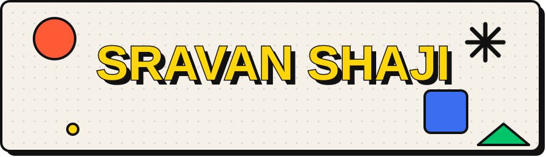

## ✨ things i've made

| | project | what it does |
|---|---|---|
| 📝 | [**ListOff**](https://github.com/Srv532/ListOff) · [try it](https://listoff.vercel.app) | type any topic, get a ranked list for it |
| 🍳 | [**reciper**](https://github.com/Srv532/reciper) · [try it](https://reciper-ecru.vercel.app) | recipe generator with a sketchbook look |
| 🔎 | [**gitman**](https://github.com/Srv532/gitman) | look up any github profile or repo and see its stats |
| 🛡️ | [**WalletGuardian**](https://github.com/Srv532/WalletGuardian) | MCP server that checks expense reports against company rules |
| 📱 | [**CyberPulse**](https://github.com/Srv532/CyberPulse) | android app for security news and breach alerts (kotlin + compose) |
| 🎮 | [**Escape from Lunars**](https://github.com/Srv532/Escape-from-Lunars) · [play](https://efl-eight.vercel.app) | endless runner on indian streets, made with phaser |
| 🌍 | [**ChronoEarth**](https://github.com/Srv532/ChronoEarth) | college team project, scroll through the history of the earth |

## 🧰 stuff i use

## 📊 numbers

## 🔐 security

my writeups from the bi0s tasks (bandit, cryptohack, blockchain basics) live in [this repo](https://github.com/Srv532/Bios-WriteUps-of-SRAVAN-SP-pentagonia-).

## 🚧 right now

working on [**MnemosyneLens**](https://github.com/Srv532/MnemosyneLens), a photography portfolio site.

 

